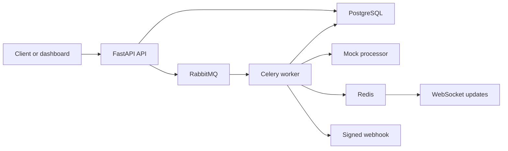

# NexusData

An event-driven document-processing reference application built with FastAPI, Celery and PostgreSQL.

The API accepts a document-processing request, creates a job and returns `202 Accepted`. A background worker processes the job, records its status and can notify clients through signed webhooks or WebSocket updates. A React dashboard exposes ingestion, job tracking, API keys and webhook management.

**Current processing uses a deterministic mock adapter.** External AI providers and semantic search are extension points on the roadmap.

## Implemented scope

- JWT authentication, API keys with scopes and administrator/user roles.
- Tenant-scoped access in application services and repositories.
- Idempotent ingestion, request fingerprint checks and database uniqueness constraints.
- Background processing with retries and a circuit breaker.
- HMAC-signed webhook delivery, URL validation and IP pinning.
- WebSocket job updates and a React/Vite dashboard.
- Structured logging, Prometheus metrics and OpenTelemetry instrumentation.
- Alembic migrations, unit tests and database integration tests.

These are implementation features. Deployment readiness, throughput and latency require separate verification.

## Architecture



The Python application separates domain rules, application services, infrastructure adapters and HTTP/WebSocket presentation. See [the application package](src/nexusdata), [processor factory](src/nexusdata/infrastructure/ai/factory.py) and [worker](src/nexusdata/worker).

| Area | Tools |
| --- | --- |
| API and validation | Python 3.12+, FastAPI, Pydantic |
| Persistence | PostgreSQL, SQLAlchemy, Alembic |
| Background work | Celery, RabbitMQ |
| Shared state | Redis |
| Dashboard | React, TypeScript, Vite |
| Local environment | Docker Compose |
| Checks | Ruff, Mypy, Pytest, Testcontainers |

Qdrant is included in the local Compose environment; the current processor does not implement semantic search.

## Local development

Prerequisites: Docker with Compose, Python 3.12+, `uv`, and GNU Make with Bash. On Windows, the Makefile expects a Bash-compatible environment.

```bash
git clone https://github.com/cesaints/nexusdata.git
cd nexusdata
cp .env.example .env
make install
make up
make migrate
make seed
```

Review the example configuration and use a development database. `make seed` writes demonstration data; inspect its source before using it with an existing database. Configuration values belong in the local environment.

The API documentation is served at [localhost:8000/docs](http://localhost:8000/docs). To start the dashboard with the repository's development target:

```bash
make front
```

The dashboard's Vite development server uses [localhost:5173](http://localhost:5173).

The commands above are defined in the [Makefile](Makefile). They were checked against source for this documentation revision; a fresh local setup was not executed during that review.

## API overview

The API routes use the `/api/v1` prefix.

| Route | Purpose |
| --- | --- |
| `POST /auth/register` | Create a tenant and administrator |
| `POST /auth/login` | Issue authentication tokens |
| `POST /auth/refresh` | Refresh authentication |
| `POST /documents/process` | Submit work and receive a job identifier |
| `GET /jobs` | List accessible jobs |
| `GET /jobs/{id}` | Read a job's status |
| `POST /api-keys` | Create an API key |
| `POST /webhooks` | Register a webhook |
| `WS /ws/jobs` | Receive job updates |

Use the running OpenAPI documentation for request schemas and authorization requirements.

## Verification

```bash
make check
make test-unit
make test-int
```

The [CI workflow](.github/workflows/ci.yml) runs lint and type checks, unit tests with an 80% coverage gate, database integration tests, frontend compilation and secret scanning. Integration tests use PostgreSQL through Testcontainers.

See [GitHub Actions](https://github.com/cesaints/nexusdata/actions/workflows/ci.yml) for the result of each revision. The Docker image job runs on pushes to `main` and `develop`, and is skipped on pull requests. Image publication and a reporting-only vulnerability scan do not establish production readiness.

This documentation describes the implemented scope. A complete local deployment and load testing remain separate verification steps.

## Known limits and next steps

- Implement real document-processing adapters; the current factory supports `mock`.
- Add a transactional outbox to address the database-write/queue-publication gap.
- Encrypt stored webhook secrets using a suitable key-management design.
- Replace WebSocket query-string tokens with a ticket or subprotocol flow.
- Add token revocation and refresh-token replay handling.
- Restrict operational metrics in a deployed environment.
- Verify deployment configuration and operational behavior before production use.

Idempotency handles specific replay scenarios; it is not a claim of end-to-end exactly-once processing.

## Project status and rights

This repository is a reference application with documented operational work remaining. No production deployment or load-test result is asserted here.

The [Python manifest](pyproject.toml) currently declares `Proprietary`. No standalone license file was present in the reviewed revision.
