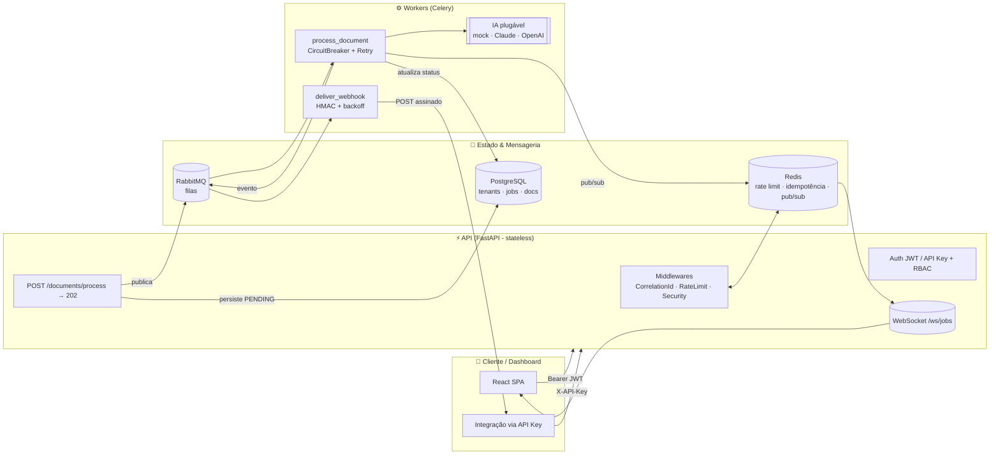
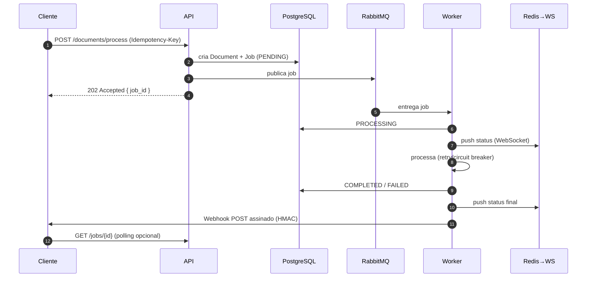

<div align="center">

# 🛰️ NexusData

**Plataforma Multi-Tenant de Processamento Assíncrono e Inteligente de Documentos (IDP)**

*API orientada a eventos que recebe grandes volumes de dados não estruturados, valida, enfileira, processa em background (workers + IA), persiste o resultado estruturado e notifica os clientes via Webhook ou WebSocket.*

`Python 3.12+` · `FastAPI` · `SQLAlchemy 2.0 async` · `PostgreSQL` · `Redis` · `RabbitMQ + Celery` · `Docker`

</div>

---

## 📌 O Problema

Empresas de jurídico, contabilidade, e-commerce e RH recebem **milhares de arquivos não estruturados por dia** (contratos, notas fiscais, tickets). Elas precisam extrair dados, validar regras de negócio e integrar com outros sistemas. **APIs tradicionais dão _timeout_** ao tentar processar isso de forma síncrona.

## ✅ A Solução

Uma API **assíncrona e orientada a eventos**: a ingestão responde em milissegundos (HTTP `202 Accepted`), o trabalho pesado roda em **workers desacoplados**, e o cliente é notificado quando termina — com resiliência (retry, circuit breaker), isolamento multi-tenant e observabilidade de produção.

---

## 🏗️ Arquitetura



### Fluxo de uma ingestão (sequência)



### Clean Architecture (dependências apontam para dentro)

```
presentation ─▶ application ─▶ domain ◀─ infrastructure
    (FastAPI)     (use cases)    (puro)     (SQLAlchemy, Redis, Celery…)
```

| Camada | Responsabilidade | Depende de |
|---|---|---|
| **domain** | Entidades, regras de negócio, máquina de estados do job, interfaces (Protocols) | nada (Python puro) |
| **application** | Casos de uso, DTOs, _ports_ | domain |
| **infrastructure** | Implementações concretas dos ports (DB, cache, mensageria, IA, segurança) | domain, application |
| **presentation** | Rotas HTTP/WS, middlewares, tradução de erros | todas |

> O domínio **não importa** SQLAlchemy, FastAPI, Redis ou Celery. Trocar qualquer tecnologia é uma mudança localizada na infraestrutura + no `Container` (composition root).

---

## 🔐 Segurança (defesa em profundidade)

> *"Não deve ser porque uma pessoa tem acesso ao código que consegue hackear o sistema."* — nada de segredo no código; a segurança vem de design, não de obscuridade.

- **Senhas com Argon2id** (vencedor da PHC), verificação em tempo constante e _rehash_ transparente.
- **JWT endurecido**: algoritmo **fixo** na decodificação (bloqueia `alg=none`/confusion), claims obrigatórias (`exp`, `iat`, `nbf`, `sub`, `tid`, `type`), `aud`/`iss` verificados, `jti` por token.
- **Isolamento multi-tenant** garantido em 3 camadas: middleware/auth → serviço (checagem explícita) → repositório (queries sempre escopadas por `tenant_id`). 404 (não 403) em recursos de outro tenant, para não revelar existência.
- **RBAC** (Admin/User) + **API Keys com escopos** (privilégio mínimo). Segredo da API key exibido **uma única vez**; só o hash é persistido.
- **Rate limiting distribuído** (Redis, janela atômica via Lua) por API key / sessão / IP.
- **Idempotência** em 2 níveis: `Idempotency-Key` (cache de resposta no Redis, com detecção de reuso de chave com corpo diferente) **e** _unique constraint_ no banco.
- **Webhooks assinados com HMAC-SHA256** (esquema anti-replay estilo Stripe) + **defesa anti-SSRF** (bloqueio de IPs privados/loopback/link-local/metadata `169.254.169.254`) + HTTPS obrigatório.
- **Erros seguros**: exceções internas nunca vazam ao cliente — viram `500` genérico; o detalhe fica só no log com `correlation_id`.
- **Cabeçalhos de segurança** (CSP, X-Frame-Options, nosniff, Referrer-Policy, HSTS em produção), **CORS restrito** a origens explícitas, `extra="forbid"` em todos os inputs.
- **Segredos** sempre em `SecretStr`; validador impede subir produção com segredo padrão/fraco.
- Celery aceita **apenas JSON** (nunca `pickle` — evita RCE por desserialização).

### 🎯 Red-team (o sistema foi atacado antes de ser aprovado)

Uma equipe de segurança independente (4 lentes: authz/isolamento, injeção/SSRF,
cripto/vazamento, DoS/concorrência) tentou derrubar o sistema. **Achados reais
corrigidos e cobertos por testes de regressão:**

| # | Falha | Correção |
|---|---|---|
| A | SSRF por **DNS-rebinding** (TOCTOU) no webhook | Resolve 1×, **fixa o IP validado** na conexão (SNI/cert seguem o hostname) |
| B | **Bypass de rate-limit** por header forjável (buckets ilimitados) | Chave sempre por **IP do socket** (não confia em `X-API-Key`/`Authorization`) |
| C | Job preso em `PROCESSING` em erro não-`ProcessorError` | `except Exception` amplo roteia p/ retry/falha |
| D | Redelivery duplicada em `PROCESSING` levantava erro | No-op idempotente para job já em processamento |
| E | `raw_payload`/corpo sem limite → OOM | Middleware de tamanho de corpo (413) |
| F | Reserva de idempotência presa por 24h em crash | TTL curto (60s) no placeholder `in_progress` |
| G | WebSocket sem limite → exaustão de FD | Cap por tenant e global |
| H | Tenant desativado ainda autenticava (API key) | Auth de API key valida `tenant.is_active` |
| I | Hardening de produção incompleto | Bloqueia senhas default de DB/RabbitMQ e exige chave de IA |
| J | Regex de correlation-id aceitava `\n` final | `fullmatch` (defesa contra CRLF) |

**Tradeoffs residuais conscientes** (documentados, endereçados no roadmap):
o secret do webhook é reversível por design → **cifrar em repouso (KMS)**; o token
do WebSocket vai na query string → migrar para **subprotocolo/ticket**; o *dual-write*
(job `PENDING` + publish) precisa de **Transactional Outbox**; revogação de JWT via
denylist (`jti`); `/metrics` deve ficar **restrito por rede** em produção.

---

## 🚀 Começando (ambiente local)

Pré-requisitos: **Docker** + **Docker Compose**. (Opcional para rodar fora do container: **uv** e Python 3.12+.)

```bash
# 1. Configure o ambiente
cp .env.example .env            # ajuste segredos se quiser

# 2. Suba tudo (Postgres, Redis, RabbitMQ, Qdrant, API, Worker, Prometheus, Grafana)
make up                         # docker compose up -d --build

# 3. Rode as migrations e popule um tenant de exemplo
make migrate
make seed                       # cria tenant "acme" + admin@acme.test

# 4. Acesse
#    API .......... http://localhost:8000/docs
#    RabbitMQ ..... http://localhost:15672  (nexus / nexus_dev_password)
#    Grafana ...... http://localhost:3000   (admin / admin)
#    Frontend ..... http://localhost:5173   (make front)
```

### Rodando sem Docker (desenvolvimento)

```bash
make install     # uv sync --all-extras --group dev
make hooks       # instala os git hooks (pre-commit)
make run         # sobe a API com reload
make worker      # em outro terminal: sobe o worker Celery
```

---

## 📚 Principais endpoints

| Método | Rota | Auth | Descrição |
|---|---|---|---|
| `POST` | `/api/v1/auth/register` | — | Cria tenant + admin |
| `POST` | `/api/v1/auth/login` | — | Emite access + refresh token |
| `POST` | `/api/v1/auth/refresh` | — | Renova tokens |
| `GET`  | `/api/v1/auth/me` | JWT/Key | Identidade do principal |
| `POST` | `/api/v1/documents/process` | JWT/Key | **Ingestão → 202 + job_id** |
| `GET`  | `/api/v1/jobs/{id}` | JWT/Key | Status do job (polling) |
| `GET`  | `/api/v1/jobs` | JWT/Key | Lista jobs (paginado) |
| `POST` | `/api/v1/api-keys` | Admin | Cria API key (segredo 1x) |
| `POST` | `/api/v1/webhooks` | Admin | Registra webhook (secret 1x) |
| `WS`   | `/api/v1/ws/jobs?token=…` | JWT | Status em tempo real |
| `GET`  | `/health/ready` · `/metrics` | — | Ops (Prometheus) |

Exemplo de ingestão idempotente:

```bash
curl -X POST http://localhost:8000/api/v1/documents/process \
  -H "Authorization: Bearer $TOKEN" \
  -H "Idempotency-Key: 7c9e...unique" \
  -H "Content-Type: application/json" \
  -d '{"doc_type":"invoice","raw_payload":{"invoice_number":"NF-123","total_amount":1990}}'
# → 202 { "job_id": "…", "status": "pending", "idempotent_replay": false }
```

---

## 🧪 Qualidade & Testes

```bash
make check      # ruff (lint) + mypy (tipos estritos)
make test       # pytest + cobertura (falha se < 80%)
make test-int   # testes de integração com Testcontainers (Postgres/Redis reais)
```

- **Testes unitários** isolam I/O com fakes in-memory dos ports.
- **Testes de integração** sobem Postgres/Redis reais via **Testcontainers**.
- **CI** (GitHub Actions): Ruff → Mypy → Pytest (cobertura ≥ 80%) → build da imagem Docker.

---

## 🧠 Decisões arquiteturais (o "porquê")

> **Por que RabbitMQ + Celery em vez de processar no request?**
> Resiliência e desacoplamento. Se a API reiniciar, a requisição em memória seria perdida; na fila, a mensagem fica **persistida**. Processar inline bloquearia o event loop e esgotaria memória sob carga. Com workers, escalo **ingestão (API)** e **processamento (workers)** de forma independente.

> **Por que Unit of Work + Repository?**
> Transações atômicas explícitas e queries testáveis/desacopladas do ORM. A integridade (unicidade, idempotência) é garantida por **constraints no banco**, não só por checagens de aplicação — resistente a corridas.

> **Como garanto _exactly-once_ com entrega _at-least-once_?**
> O worker usa `SELECT … FOR UPDATE` + checagem de estado terminal: entregas duplicadas do mesmo job são **idempotentes**. A `Idempotency-Key` protege a ingestão.

> **Por que o worker mantém um event loop persistente?**
> Combinar Celery (prefork) com SQLAlchemy/redis assíncronos exige reusar o mesmo loop por processo — evita o clássico *"future attached to a different loop"*.

---

## 📁 Estrutura do projeto

```
nexusdata/
├── src/nexusdata/
│   ├── domain/          # Entidades, value objects, exceções, interfaces (puro)
│   ├── application/     # Casos de uso, DTOs, ports
│   ├── infrastructure/  # DB, cache, mensageria, IA, segurança, observabilidade
│   ├── presentation/    # FastAPI: rotas, middlewares, WebSocket, deps
│   └── worker/          # Celery app + tasks
├── alembic/             # Migrations versionadas
├── tests/               # unit · integration
├── frontend/            # Dashboard React + Vite
├── docker/              # Dockerfiles
├── .github/workflows/   # CI/CD
├── docker-compose.yml
└── pyproject.toml
```

---

## 🗺️ Roadmap (pós-slice)

- [ ] Transactional Outbox + sweeper para publicação garantida (fecha o dual-write)
- [ ] Cifrar secrets de webhook em repouso (envelope encryption / KMS)
- [ ] Token do WebSocket via subprotocolo ou ticket de uso único (fora da query string)
- [ ] Denylist de JWT (revogação via `jti`) + rotação com detecção de replay
- [ ] Integração real de IA (Claude/OpenAI) + busca semântica (Qdrant)
- [ ] Terraform (ECS/RDS/ElastiCache) — IaC nível arquiteto
- [ ] `/metrics` restrito por rede + rate-limit por principal autenticado (sliding window)

---

<div align="center">
Construído com foco em <b>resiliência</b>, <b>segurança</b> e <b>clareza arquitetural</b>.
</div>
